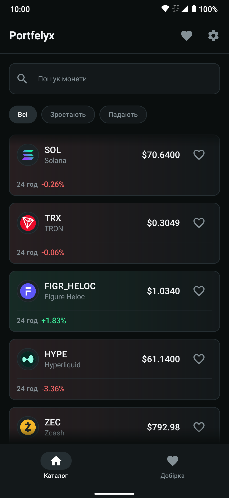
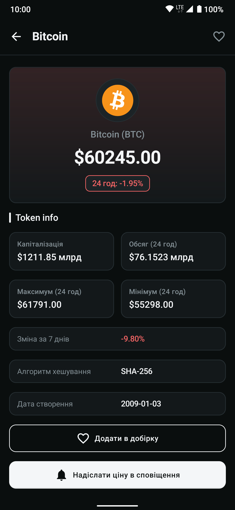
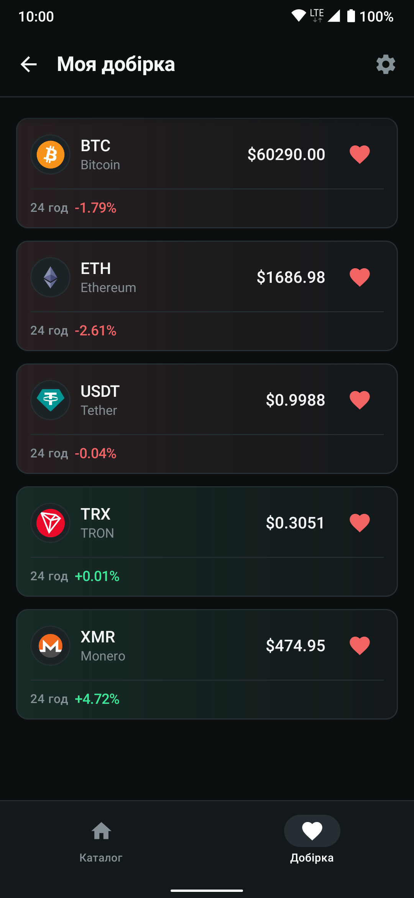
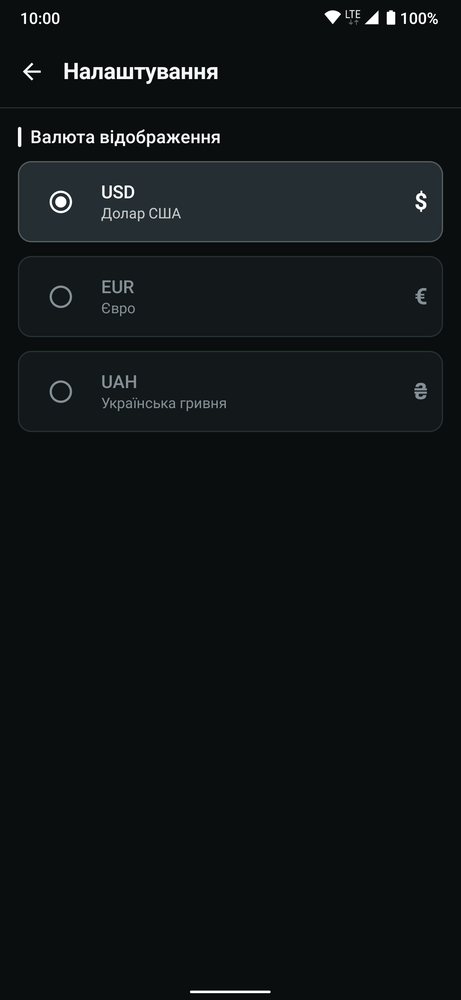
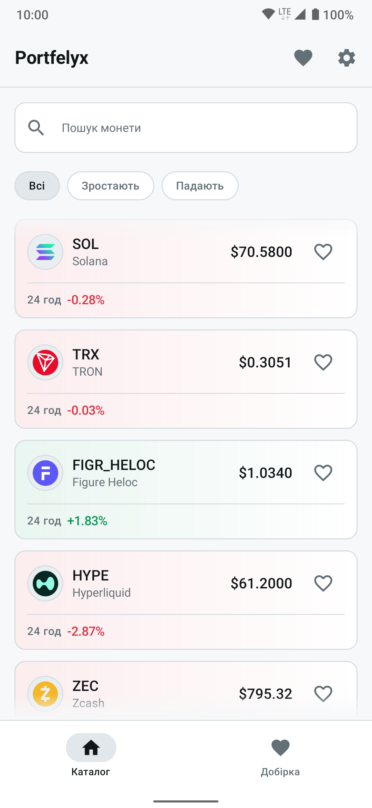

# Portfelyx

Мобільний Android-застосунок для відстеження актуальних курсів криптовалют у реальному часі на базі CoinGecko API.

## Опис застосунку

Portfelyx надає швидкий доступ до ринкових даних криптовалют без реєстрації та сторонніх акаунтів:

1. **Каталог:** список криптовалют із логотипами, актуальними цінами, зміною за 24 години та 7 днів, пошуком із затримкою (debounce) та кнопкою очищення, фільтрацією за напрямком руху (`Всі`, `Зростають`, `Падають`) і оновленням свайпом (`PullToRefreshBox`).
2. **Деталі монети:** велика картка з ціною, індикатором добової зміни та динамічним верхнім градієнтом фону (зелений при зростанні, червоний при падінні), блок ринкових метрик `Token info` (капіталізація, обсяг торгів за 24 год, максимум і мінімум за 24 год, зміна за 7 днів, алгоритм хешування, дата створення), додавання в добірку та надсилання локального сповіщення про поточний курс.
3. **Моя добірка:** особистий список обраних монет, збережений локально у `Preferences DataStore`, із відображенням актуальних курсів у вибраній валюті.
4. **Налаштування:** вибір валюти відображення (`USD`, `EUR`, `UAH`), що автоматично синхронізується між усіма екранами.
5. **Оформлення та адаптивність:** власна світла й темна теми Material 3, адаптивна векторна іконка, стартовий Splash-екран (Android 10+) та підтримка портретної й альбомної орієнтацій.

## Скріншоти

| Каталог (темна) | Деталі (темна) | Добірка (темна) | Налаштування (темна) | Каталог (світла) |
| --- | --- | --- | --- | --- |
|  |  |  |  |  |

## Технологічний стек

- **Мова:** Kotlin 2.2
- **UI:** Jetpack Compose, Material 3, AndroidX Core SplashScreen
- **Навігація:** Navigation Compose
- **Архітектура та асинхронність:** Lifecycle ViewModel, Kotlin Coroutines, StateFlow
- **Мережа та серіалізація:** Retrofit 2, `kotlinx.serialization` (JSON), CoinGecko API v3
- **Зображення:** Coil Compose (`AsyncImage`)
- **Локальне збереження:** Jetpack Preferences DataStore
- **Оптимізація релізу:** Android Gradle Plugin 9.4 (R8 code & resource shrinking, `rules.keep`)
- **Мінімальна версія Android:** Android 10 (API 29), `compileSdk` / `targetSdk`: 37

## Як зібрати

### 1. Налаштування `local.properties`

У корені проєкту створіть файл `local.properties` (файл додано в `.gitignore`):

```properties
# Обов'язковий шлях до Android SDK
sdk.dir=/шлях/до/Android/Sdk

# Безкоштовний Demo API ключ CoinGecko (рекомендовано для вищого ліміту запитів)
coingecko.api.key=ваш_demo_api_ключ

# Необов'язкові параметри підпису (потрібні лише для підписаної release-збірки)
release.store.file=шлях/до/keystore.jks
release.store.password=пароль_сховища
release.key.alias=аліас_ключа
release.key.password=пароль_ключа
```

> Застосунок працює і без `coingecko.api.key`, але зі спільним лімітом CoinGecko на IP. За відсутності полів `release.store.*` debug-збірка працює без помилок.

### 2. Команди Gradle

Якщо `JAVA_HOME` не налаштовано глобально, вкажіть шлях до JBR Android Studio (наприклад, `JAVA_HOME=/opt/android-studio/jbr`):

```bash
# Збірка debug APK
./gradlew :app:assembleDebug

# Збірка release APK та AAB з мінімізацією R8
./gradlew :app:assembleRelease :app:bundleRelease
```

Артефакти релізу створюються у:
- `app/build/outputs/apk/release/app-release.apk`
- `app/build/outputs/bundle/release/app-release.aab`
- `app/build/outputs/mapping/release/mapping.txt`
